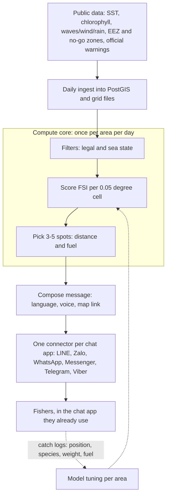
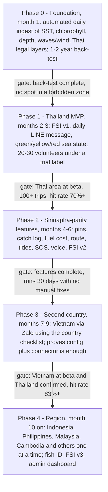

# ARCHITECTURE.md — Pelago Asia

This document has two halves that must not be confused:

- **Part A — Target architecture**: what the team intends to build, taken from the three reference documents (below).
  Nothing in Part A exists in this repository yet.
- **Part B — This repository today**: a static front-end prototype, described from the code on `main`, with a gap
  analysis against Part A.

Rules for working on it are in [`AGENTS.md`](AGENTS.md); the current plan is in [`TASK.md`](TASK.md).

## Reference documents

The product intent comes from three team documents (Thai, not stored in this repository). Statements below are
summaries of them and are cited like this: **(G p.N)**, **(S p.N)**, **(D)**.

| Tag | Document | Date |
| --- | --- | --- |
| G | *Build guide: satellite-based fishing-ground platform for all of Asia* (คู่มือสร้างแพลตฟอร์มหาแหล่งปลาด้วยดาวเทียมสำหรับทั่วเอเชีย), 16 pages | 2026-11-21 |
| S | *Function specification for developers* (สเปกฟังก์ชันสำหรับพัฒนา แพลตฟอร์มหาแหล่งปลาทั่วเอเชีย), 16 pages | 2026-11-24 |
| D | *Satellite and geospatial data sources for the prototype* (แหล่งข้อมูลดาวเทียมและภูมิสารสนเทศสำหรับต้นแบบ) | 2026-11-25 |

Licence terms, prices and dataset names in those documents were written on those dates. **D itself says the dataset
names and variables were checked against each source's documentation but not yet run against real servers.** Verify
before relying on any of them, especially anything about commercial use or messaging prices.

---

# Part A — Target architecture (from the reference documents)

## A1. Goal and principles

A platform that tells small-scale fishers every morning **where to fish, whether it is safe, and how much fuel it
will cost**, using only public satellite data, delivered through the chat app each country already uses, and meant to
work across Asia, not only as a demo **(G p.1)**. The benchmark is SIRINAPHA Baan-Pla Link (KMUTT): in a Samut
Sakhon trial its index matched real catch points in more than 83% of areas and cut fuel use by 18–30%. Our system must
reach the same figures or better, measured the same way **(G p.1)**.

Four working principles **(G p.1)**:

1. **Safety before accuracy.** If waves or wind are dangerous, say "do not go out" before showing any fishing spot.
2. **Never claim accuracy that has not been measured.** Every area shows a confidence level that matches the data it
   really has.
3. **Usable with low literacy and weak internet.** Numeric coordinates, small images, voice messages.
4. **A fisher's data belongs to the fisher.** One person's secret spots are never shown to anyone else.

What makes it different from SIRINAPHA **(G p.1)**: multi-country from line one (languages, chat apps, time zones); a
legal/safety guard (other countries' waters, protected zones, closed seasons) as the core, not an add-on; and catch
logs fed back to retune the model per area, so new areas do not need field visits everywhere.

## A2. System shape

The system computes **once per area per day**, then fans out into per-person messages, so compute cost does not grow
with the number of users. Adding a country means adding configuration and a chat connector, not changing the core
**(G p.7)**.



Layers (top to bottom in the guide's diagram) **(G p.7)**: public data sources → automated daily ingest → compute core
(filter → FSI → spot picking) → message composition → per-app connectors → fishers, with a feedback loop from catch
logs into model tuning.

### Recommended technology **(G p.7–8)**

| Part | Technology | Why |
| --- | --- | --- |
| Fetch and compute | Python: xarray, numpy, rasterio, shapely | standard satellite-data tooling |
| Scheduling | Prefect or cron in the cloud | retry when a source is down, alert when a job does not finish |
| Database | PostgreSQL + PostGIS | zones, points, user logs, fast spatial queries |
| Raw storage | cloud storage, Zarr or COG files | cheap, read only the area needed |
| API / webhook | FastAPI | one entry point for all chat apps |
| Send queue | Redis + worker | send at local time, respect each app's rate limit |
| Map page | light web page + MapLibre | opens from a chat link, no app install |
| Voice | text-to-speech with local-language support | for low-literacy users |
| Monitoring | Sentry + a data-freshness dashboard | know at once when an area stops updating |

**Design rule (G p.8): everything that differs by country (language, time zone, units, app, thresholds) lives in
configuration, not code, and every data source sits behind a swappable fetcher.**

### Cross-cutting rules for every function **(S p.2)**

| Topic | Rule |
| --- | --- |
| Time | store UTC everywhere; display in the local time of the user's port |
| Coordinates | WGS84, 4 decimals (about 11 m); show decimal or degrees-minutes, user's choice |
| Compute grid | 0.05° cells (about 5 km); one cell-id scheme computed from coordinates, shared by all functions |
| Units | km and nautical miles; km/h and knots; waves in m; fuel in litres; money in the area's currency |
| Chat text | in translation files, never in code (first version: Thai only) |
| Data age | every message and map shows the date of the satellite data it used |
| Personal data | collect the minimum; encrypt phone numbers and private positions; deletable with one command |
| Area config | one file per area; every value is a starting value to be tuned on real data |

Example area config **(S p.3)** — the numbers are illustrative, not validated:

```json
{
  "region_id": "th-upper-gulf", "country": "TH", "timezone": "Asia/Bangkok", "currency": "THB",
  "languages": ["th"], "bbox": [99.9, 12.5, 101.0, 13.6],
  "ports": [{"id": "tha-chalom", "name": "ท่าฉลอม", "lat": 13.53, "lon": 100.28}],
  "boat_classes": {"small": {"max_range_km": 30, "wave_yellow_m": 1.0, "wave_red_m": 1.5,
                             "wind_yellow_kmh": 20, "wind_red_kmh": 30}},
  "fsi_weights": {"sst": 0.2, "front": 0.2, "chl": 0.25, "depth": 0.15, "moon": 0.1, "season": 0.1},
  "fuel_price_per_litre": null,
  "legal_layers": ["eez", "protected", "seasonal_closure", "boat_class_zones"],
  "channels": ["line"]
}
```

## A3. Functions

Core functions are C1–C14, later-phase L1–L2, extras E1–E7. Build in code order; "needs" means must exist first
**(S p.1–2)**. Each function in S is specified as: what it does · inputs · how · outputs · edge cases · done when.

| Code | Function | Phase | Needs |
| --- | --- | --- | --- |
| C1 | Sign-up and user profile (chat conversation, under 2 minutes, consent, "delete my data") | 1 | — |
| C2 | Daily satellite and forecast ingest (retry 3×, fall back to backup source, then to latest data with its age) | 0 | — |
| C3 | Safety and no-go filter (legal masks, closed seasons, boat-class zones, sea state, official warnings) | 0 | C2 |
| C4 | Fish-suitability index (FSI), per target species group | 1 | C2, C3 |
| C5 | Recommended spots and the morning chat message | 1 | C1, C4, C7 |
| C6 | 7-day wave / wind / rain outlook (green / yellow / red) | 1 | C2, C3 |
| C7 | Route, distance and fuel cost | 1 | C1, C3 |
| C8 | Tide times per port | 2 | C1 |
| C9 | Private pins (visible only to their owner) | 2 | C1 |
| C10 | Catch log (the most important input for accuracy) | 2 | C1, C5 |
| C11 | Fish species ID from a photo | 2 | C10 |
| C12 | Web map dashboard (private and public modes) | 2 | C4, C6 |
| C13 | Mangrove monitoring (NDVI) | 2 | C2, C12 |
| C14 | Admin dashboard | 1 | C2 |
| L1 / L2 | 7–30-day catch outlook; mangrove restoration and blue-carbon plan | 3–4 | C10 (1 year) / C13 |
| E1 | "Go / don't go" decision helper | 3 | C5, C7, C10, E2 |
| E2 | Fish price at the landing today | 3 | C10 |
| E3 | Plankton-bloom and polluted-water warning | 3 | C2 |
| E4 | Voice messages (listen and speak) | 3 | C5, C10 |
| E5 | SOS and check-out / check-in | 3 | C1 |
| E6 | Multiple chat apps | 3 | C5 |
| E7 | Multiple languages | 3 | C5 |

C3 and C6 are not extras: SIRINAPHA also warns about waves and wind, and recommending a spot in a forbidden zone can
get a fisher arrested, so both exist from day one **(S p.2)**.

**The phase numbers in G and S disagree.** S says its phases match G's plan, but the two differ for these features
(G p.2 feature table and G p.13 plan vs. S p.1–2):

| Feature | G puts it in | S puts it in |
| --- | --- | --- |
| Fuel cost and route (C7) | phase 2 | phase 1 |
| Admin dashboard (C14) | phase 1 in its own feature table (p.2) but listed under phase 4 in the plan (p.13) | phase 1 |
| Fish ID from photo (C11) | phase 4 | phase 2 |
| Fish price, bloom warning, SOS, voice (E2–E5) | phase 2 (voice 2–3) | phase 3 |
| Go / don't go (E1) | phase 1 for cost + safety, phase 2 for profit | phase 3 |

S is the newer document (2026-11-24 vs. 2026-11-21), so this file's table above follows S. The owner needs to decide
which plan is authoritative (open question in `TASK.md`).

Selected "done when" targets **(S)**: C2 runs 14 days in a row without manual fixes and switches to the backup source
by itself; C3 has an automated test that no recommended spot falls in a no-go zone over the last 90 days; C4 computes
a whole area in under 10 minutes; C5 delivers on time (±5 minutes) to 99% of users; C12's first page is about 500 KB
and opens within 5 seconds on 3G.

## A4. The FSI model **(G p.8–9)**

FSI starts as an expert-weighted formula and becomes a learned model when enough verified catch logs exist. Cells are
0.05°, and only cells that already passed the legal and safety filter are scored.

Six sub-scores, each 0–1: `S_sst` (bell curve around the target species' preferred temperature), `S_front`
(temperature gradient as a percentile within the area), `S_chl` (log chlorophyll in the good range, **cut to zero above
the bloom threshold** because blooms mean low oxygen), `S_depth` (full score where the gear works), `S_moon` (depends on
the fishery; for light-assisted fishing such as squid the score is higher around the waning moon, because moonlight
weakens the lure lights), `S_season` (starts flat, then learned).

```
v1  (new area, no catch logs)   FSI = 100 * sum(w_i * a_i * S_i) / sum(w_i * a_i)
                                w_i = weight, a_i = freshness of the data (1 = today, lower if old or cloudy)
v2  (about 300 verified trips)  FSI = 100 * sigmoid(b0 + sum(b_i * x_i))      logistic regression
v3  (thousands of trips)        tree model such as LightGBM, plus ocean-current and sea-surface-height variables;
                                replaces v2 only if it wins on spatial cross-validation (split by area and time)
```

If chlorophyll is missing for several days the formula leans on the other variables **and the reported confidence must
drop**. A cell with no SST at all gets no score (not zero) **(S p.7)**. A new area with no catch logs can reach at most
"medium" confidence **(S p.7)**.

From score to spots **(G p.9)**: drop cells outside the allowed zone or beyond the boat's safe round-trip range or
where waves/wind exceed the boat class threshold → choose the 3–5 highest-FSI cells at least 5 km apart (so every boat
does not pile onto one point) → attach distance, estimated fuel cost and confidence (high / medium / low) to each.

## A5. Safety and legal filters **(G p.9–10, S p.6)**

Principle: **"unknown = do not recommend."** If an area lacks complete legal-zone data, or the wave/wind forecast is
missing, the system sends no spot for it (a missing forecast is treated as yellow and the user is told).

Filters every spot must pass, in order:

1. Inside the user's country EEZ, with a buffer of at least 5 km from the border (the dataset's line is not a legal line).
2. Not in a disputed area (areas claimed by several countries are removed for everyone).
3. Not in a protected or no-take zone (marine parks, coral, seagrass, gear-restricted zones).
4. Not in a closed season (stored as layers with start/end dates, checked at every run).
5. In a zone where that boat class may fish (by distance from shore and boat size).
6. Waves and wind under the boat class threshold for the **whole time at sea** (default window 04:00–14:00 local).
7. No official warning. If the national met agency bans departures the system sends only the warning, even if our own
   wave model says it is safe.

Sea-state thresholds (starting values, to be tuned with local fishers and agencies before real use):

| Boat class | Yellow (caution) | Red (do not go out) |
| --- | --- | --- |
| Small, under 10 m | wave ≥ 1.0 m or wind ≥ 20 km/h | wave ≥ 1.5 m or wind ≥ 30 km/h, or thunderstorms |
| 10–18 m | wave ≥ 1.5 m or wind ≥ 30 km/h | wave ≥ 2.5 m or wind ≥ 40 km/h |

Text that must always be shown: the spots are satellite estimates, **not legal boundaries and not a substitute for
official announcements** (the EEZ dataset itself says it is not made for navigation or legal use) **(G p.10)**.

Misuse limits **(G p.10)**: never show another user's position or pins; catch logs retune the model only in aggregate;
no large commercial fleets in the first phase (they would compete with small-scale fishers for the same spots);
privacy laws apply (e.g. Thailand PDPA, Philippines Data Privacy Act, Indonesia PDP law): consent at sign-up and a
"delete my data" command.

## A6. Decision tools

**Go / don't go (E1) (G p.3–4).** One answer every morning: worth going or not, with an expected profit range.

```
E[profit] = (p * Q_good + (1 - p) * Q_normal) * P  -  F  -  C
  p        chance of a good catch at the suggested spot (from FSI v2+)
  Q_*      kg caught on good / normal days, from that user's logs in the same season (else the boat-class median)
  P        price per kg (landing median, or the user's own)
  F        fuel = round-trip km * litres/km * local fuel price      C  other costs per trip
```

Computed again for the 25th and 75th percentiles so the user sees a **range, never one number**. Decision order:
red sea state or an official warning → "do not go", **no profit shown**; not enough data (under 5 user trips or the
area not yet beta) → costs and sea state only, "profit cannot be estimated yet"; otherwise lower end positive → worth
it, middle positive but lower end negative → marginal, middle negative → not worth it; a yellow sea can be at best
"marginal" with a warning. Money is always in local currency. First version: same-day round trips only. The user
answers three short questions each evening (kg caught, price, litres used), which tunes Q, P and fuel rate for that person.

**Fuel (C7) (S p.8–9).** `fuel_litre = (d_go + d_return) * litres_per_km * (1 + reserve)`, `cost = fuel_litre * price`.
Straight line if it crosses no land or forbidden cell, else A* on the sea grid avoiding land, no-go and red cells.
Calibrated: after 5 real trips the estimate should be within 25% of actual fuel used.

**Fish price (E2) (G p.4).** Users report landing prices (a follow-up question after each catch log). Show a price only
with at least 3 reports from at least 2 people within 48 hours, using the **median**, dropping outliers; new users have
low weight; limit reports per person per day; older than 48 h is labelled stale and not used in decisions. No reviews
or opinions about individual buyers; reporter names are never shown. A species dictionary maps many local names to one
central code.

**Plankton bloom and polluted water (E3) (G p.4–5).** Anomaly ratio against the same cell, same month, at least 3
years of history: `R = chl_today / chl_baseline`. Watch: R ≥ 2 for 2 days, or one user report. Warning: R ≥ 4 and
growing, or 3+ reports. Critical: several matching dead-fish reports or an official announcement. Cells at "warning"
or above are removed from recommendations. The satellite cannot tell whether plankton is toxic or whether shellfish is
safe to eat; only official announcements can.

## A7. Data sources **(D, G p.6)**

Core ocean data is free and mostly allowed for commercial use; three decisions are open (below). "Commercial" is as
stated in D on 2026-11-25.

| Data | Source | Commercial? | Used by |
| --- | --- | --- | --- |
| Sea-surface temperature, 0.01° daily | NASA JPL MUR SST via NOAA ERDDAP | yes | C2 C4 |
| Chlorophyll-a, 300 m coastal / 4 km global | Sentinel-3 OLCI via NOAA CoastWatch ERDDAP | yes, with Copernicus attribution | C2 C4 E3 |
| Chlorophyll backup / baseline | NASA PACE OCI; MODIS Aqua 8-day via ERDDAP (baseline only, ageing sensor) | yes | C2 C4 E3 |
| Ocean variables for FSI v3 | Copernicus Marine Service (needs attribution) | yes | C2 |
| Depth | GEBCO grid (not for navigation) | yes | C2 C4 C7 |
| Waves / wind / rain forecast | ECMWF Open Data (CC-BY-4.0, only ~2–3 days kept online, so store daily) | yes | C2 C3 C6 |
| Same, prototype only | Open-Meteo Marine | **not without a paid plan** | C6 (prototype) |
| Official warnings and forecasts (Thailand) | Thai Meteorological Department open API | public, free | C3 C6 |
| Backup forecast | NOAA GFS / WaveWatch III | yes | C2 |
| Tide tables | Hydrographic Department of the Thai Navy (annual tables, **permission needed**) or a global tide model (FES with pyTMD, licence to check) | to confirm | C8 |
| EEZ and maritime boundaries | Marine Regions (CC-BY, **not a legal line**) | yes | C3 |
| Protected areas | WDPA / Protected Planet — **no commercial use**; build the layer from each country's agencies | no | C3 (prototype only) |
| Mangrove extent, imagery | Global Mangrove Watch (CC BY 4.0); Sentinel-2 L2A via Copernicus Data Space or Earth Search | yes | C13 L2 |
| Fishing activity | Global Fishing Watch — **CC BY-NC**, internal back-testing only | no | internal testing |
| Closures and no-fishing zones | each country's fisheries department announcements (public documents, convert to maps ourselves) | yes | C3 |
| Land / coastline | Natural Earth, OpenStreetMap (attribution) | yes | C3 C7 |

Thai national sources (D): GISTDA (API key; mostly land data, not marine), TMD, Hydrographic Department, Department of
Marine and Coastal Resources, Department of Fisheries, Fish Marketing Organization (starting price reference for E2),
`data.go.th` (check each dataset's licence). **Thai data is valid only in Thailand**; each new country needs the same
set of agencies (met, hydrographic, fisheries) per the country checklist.

Operational notes: do not depend on a single server — fetch and store daily so that if a source is down the system can
still send from the latest data **with its age stated** **(G p.6)**; cloud cover in the monsoon season removes daily
chlorophyll, so use the 8-day average and lower its weight by data age; the ageing MODIS sensor means the fetcher must
be able to switch to VIIRS or newer sensors without touching other code; disputed waters (e.g. parts of the South China
Sea) are removed from all recommendations **(G p.6–7)**.

Accounts to create before writing ingest code (D): NASA Earthdata Login, Copernicus Marine Service, GISTDA API Gateway,
Thai Meteorological Department API, a Global Fishing Watch token (internal testing only), and a permission request to
the Hydrographic Department for tide tables. **All keys and passwords go in `.env` or environment variables, never in
code and never on GitHub** (the repository is public). The example fetch script `fetch_data.py` mentioned in D is not
in this repository.

Fastest data check from D (no account): `https://coastwatch.pfeg.noaa.gov/erddap/griddap/jplMURSST41.csv?analysed_sst[(last)][(12.5):5:(13.6)][(99.9):5:(101.0)]`
returns the latest SST for the upper Gulf of Thailand every 0.05°.

## A8. Chat channels **(G p.10–12)**

All apps receive the same content from the core; only the connector differs, and the sending rules and costs differ a
lot. The connector interface is one command set: send text, send location, send buttons, send image, receive message
**(S p.15, E6)**. Apps without buttons use numbers ("type 1, 2, 3").

| Country | Main app | Note from G (verify current rules and prices before launch) |
| --- | --- | --- |
| Thailand (also Taiwan, Japan) | LINE Official Account, Messaging API | free package with a quota; extra messages are bought |
| Vietnam | Zalo Official Account + ZNS | verified OA; templates must be registered; charged per message |
| Indonesia, Malaysia, India, Sri Lanka, Bangladesh | WhatsApp Business Platform | outside the 24 h window only approved templates; G states that from 2026-10-01 every message is charged, replies inside the 24 h window included |
| Philippines | Facebook Messenger | free within 24 h of the user's message; rules outside it change often |
| Cambodia | Telegram Bot API | free, with a per-second rate cap |
| Myanmar | Viber | bot fees; also check transaction restrictions |

Cost levers **(G p.11)**: have the user press "ask for tomorrow's spots" each evening so the morning message falls
inside the 24 h window; send only to people who set a fishing day; **safety warnings always go to everyone**. Morning
message layout (same in every app): 1) today's sea state, green/yellow/red with a one-line reason; 2) three spots with
numeric coordinates, distance, fuel cost, confidence; 3) a map link (light web page); 4) buttons: log a catch · listen ·
7-day forecast.

## A9. Proving accuracy **(G p.12)**

An area moves through levels, and the system may claim accuracy **only for areas at "confirmed"**.

| Level | Verified trips | Hit rate | Fuel saving | What the user sees |
| --- | --- | --- | --- | --- |
| Trial | under 100 | not measured | not measured | "trial" label on every spot; confidence at most "medium" |
| Beta | 100+ | at least 70% | measured and shown | confidence according to the model |
| Confirmed | 300+, covering 2 seasons | at least 83% | at least 18% | the area's accuracy figures |

Definitions: **hit rate** = share of trips with a good catch (above that fisher's own same-season median) that happened
in cells in the top 20% of FSI. **Fuel saving** = litres per kg of fish on days following the suggestions vs. days the
same person picked spots themselves, same season. Wave/wind accuracy is checked against buoys or open met stations;
legal safety means a spot in a forbidden zone must be a zero, checked automatically before every send.

Three tests, none needing partner organisations: back-test FSI over 1–2 years against Global Fishing Watch activity
(internal only; mostly large vessels, so it cannot prove accuracy for small boats); a volunteer group of 20–30 fishers
per area for 6–8 weeks with a small incentive; and a spatial/time split (train on one area, test on another area and
another period). Catch-log quality: positions and times come from the chat itself, photos attach, outliers are removed
before training.

## A10. Delivery plan **(G p.13)**

Each phase starts only after the previous gate passes; durations assume a team of 1–3 and are estimates. If a gate
fails, stay in the phase; do not rush new countries.



The last gate needs two seasons of Thai data, so it may run past month 9; use the wait to prepare the next country's
checklist **(G p.13)**.

**Country opening checklist (G p.15–16)**, one per country, no real spots sent until the law and safety items are done:
import EEZ and remove disputed areas with buffer; collect protected/no-take zones and closed seasons from the fisheries
agency; set boat-class zones; local lawyer reviews the disclaimer and privacy policy; check data-residency law; link the
national warning feed; tune wave/wind thresholds with at least 10 local fishers; put the national sea-rescue number in
the SOS button; automated test that no spot fell in a no-go zone in the last 90 days; fill area config (ports, species,
gear, fuel price, bloom thresholds); back-test at least 1 year; check cloud-cover share per season; confirm with 20
fishers which app they really use; open a business account and get message templates approved; compute message cost
per user per month; native-speaker review of every message (especially warnings); record voice messages. Then launch to
20–30 volunteers under a "trial" label, track hit rate / fuel / data freshness on the dashboard, and promote an area to
"beta" and "confirmed" only by the thresholds above.

## A11. Business model, costs, risks **(G p.13–15)**

Decide early whether this is a non-profit or a business, because it decides which data may be used. **Route A (social
project, recommended start)**: free for fishers, every source including non-commercial ones is usable (read each source's
"commercial" definition), funded by grants, research funds, donations, competition prizes. **Route B (business)**:
replace WDPA with official announcements, buy an Open-Meteo plan or pull NOAA/ECMWF yourself, drop Global Fishing Watch;
revenue from agencies/cooperatives, premium features for fish buyers, aggregated reports. Design for A, but keep the
switch to B a configuration change.

Main costs: messaging (grows with users × fishing days × price per message), servers and storage (per area, not per
user), commercial data (route B only), volunteer incentives and travel, and native-language review of safety text.

| Risk | Response (G p.14–15) |
| --- | --- |
| A boat has an accident after following advice | safety filters first; official warnings always win; disclaimer reviewed by a local lawyer |
| Recommending a spot in a forbidden zone | "unknown = do not recommend"; buffer; daily automated test |
| Spots inaccurate early on | "trial" label, honest confidence, start with a small group |
| Data licence breach | licence register for every source, re-check before charging users |
| Chat app changes prices or rules | separate connector per app, fallback channel (Telegram, SMS for warnings) |
| Large commercial boats take the spots | register boat class; limit spot range by boat size |
| User data leak | encrypt, keep the minimum, separate databases per country as local law requires |

---

# Part B — This repository today

## B1. What it is

A static, no-build web prototype: a Thai-language satellite globe with a fish-suitability index and small fisher tools.
It is a **front-end demo of the idea**, not an implementation of Part A. There is no backend, no database, no chat
integration, no scheduler, no legal/no-go filtering, and no AI model. Spot positions, the starting FSI values (until
live data replaces them) and the catch-journal rows are demo data, and the UI says so.

```
Browser (static files served as-is by Vercel)
  index.html + styles.css + src/*.js (ES modules)
    |-- map/       canvas globe: projection, tiles, camera, input, render loop
    |-- ui/        sidebar, popup, 12 workspace screens
    |-- data/      DEMO countries -> provinces -> spots, coastlines
    |-- services/  the only code that talks to the outside world
    |       |-- NOAA ERDDAP   (SST, chlorophyll, depth)     -> FSI v1 computed in the browser
    |       |-- Open-Meteo    (7-day wave, wind)
    |       |-- localStorage  (price reports and pins only)
    |       `-- GPS / speech synthesis
    `-- tiles: NASA GIBS and Esri imagery (display only)
```

File-by-file map: see "Project structure" in [`README.md`](README.md). Behavior checks and conventions: `AGENTS.md`.

## B2. Data flow in the prototype

1. `src/main.js` starts the app, exposes inline-handler functions on `window`, and starts the render loop.
2. `src/data/spots.js` provides the demo spot list. When a spot is shown, `fetchSpotSignal(spot)`
   (`src/services/marine-data.js`) asks NOAA ERDDAP for SST (`jplMURSST41`), chlorophyll (`nesdisVHNchlaDaily`) and depth
   (`ETOPO_2022_v1_15s`) at the spot's point, adds a computed moon phase, and `computeFsi` turns them into an FSI score
   that overwrites the demo value. Each source's success or failure goes to `sourceStatus`, shown on the data screen.
3. `src/services/weather.js` fetches a 7-day wave and wind forecast from Open-Meteo for one demo point and feeds the
   sea-status and go/no-go screens; when it fails, screens fall back to labelled sample values.
4. User-entered price reports (`pr`) and pins (`pins`) are kept in the browser (`src/services/device.js`,
   `localStorage`). The catch-journal screen shows static sample rows; nothing a user enters there is saved.
5. Everything refreshes every 30 minutes (`REFRESH_INTERVAL_MS`).

Where a backend would plug in (each file says so in its header): `src/data/spots.js` (spot list and FSI),
`src/services/marine-data.js` (`fetchSpotSignal`), `src/services/weather.js` (`loadWeekForecast`).

## B3. Prototype vs. target — gap analysis

Observed from the code on `main` (checked 2026-11-26) against Part A.

| Target (Part A) | In the prototype | Gap / note |
| --- | --- | --- |
| C2 ingest: daily, whole area, grid, backups, stored | live request per spot from the browser, no storage, no backup source | needs a server-side job and storage |
| Grid: 0.05° cells | a handful of demo points | no grid, no per-cell scores |
| C3 legal / no-go filter | **none** | the biggest safety gap; demo spots are not checked against any zone |
| C4 FSI v1: 6 sub-scores | 5 factors, weights SST 1.5, chl 1.5, depth 1, moon 0.5, season 0.5 (`src/config.js`, marked "untuned"); **no front/gradient factor**; season is a constant 0.5; moon preference is the same for all fisheries | formula shape is close (freshness-weighted average, chlorophyll bloom cut at 10 mg/m³), but not the reference weights or per-species groups. A confidence label is shown, computed two different ways: the popup (`src/ui/popup.js`) says "medium" only when SST, chlorophyll and depth are all live, else "low"; the sidebar list (`src/ui/sidebar.js`) says "medium" when the FSI score is 75 or more, else "low". Read from the code, not run: the two can disagree for the same spot, and the second is derived from the score rather than from data coverage |
| FSI v2 / v3 (learned) | none | needs verified catch logs (C10) |
| Data sources | SST: same MUR dataset as the reference. Chlorophyll: VIIRS daily (the reference's primary is Sentinel-3 OLCI, VIIRS is the backup). Depth: NOAA ETOPO 2022 instead of GEBCO (the data screen says so). Waves/wind: Open-Meteo | Open-Meteo is **free for non-commercial use only** (D); the prototype is fine, route B is not. No official warnings (data screen: "not connected") |
| C6 / C3 sea state | one boat class; thresholds in `src/ui/views.js` (`seaStatus`) equal the reference "small boat": yellow at wave ≥ 1.0 m or wind ≥ 20 km/h, red at ≥ 1.5 m or ≥ 30 km/h | no thunderstorm rule, no 10–18 m class, no "whole time at sea" window, no official-warning override |
| E1 go / no-go | red → "do not go out"; yellow → at best "marginal" wording; profit shown as "cannot be estimated yet" | follows the E1 safety rules; no profit model (needs catch logs) |
| C7 fuel | calculator: distance × rate × price × (1 + reserve), e.g. 12 × 45 × 8 = 4,320 baht, ×1.15 = 4,968 | same formula as the spec; no routing (A*) or per-boat profile |
| C8 tides | static sample values (a labelled card on the map) | no tide data |
| C9 pins / E2 price | pins and price reports are saved in `localStorage`; the price screen states the "3 reports from 2 people in 48 h" rule | no server, no aggregation, no median, no outlier or abuse control, no species dictionary |
| C10 catch log | screen with static sample rows; entries are **not** saved | the most important input for accuracy is not collected at all |
| C11 fish ID | mock-up screen that says it is not analysed by real AI; no upload | no model, no data set |
| E3 bloom warning | static explainer using the reference thresholds (R ≥ 2 / ≥ 4) | no detection; no chlorophyll baseline |
| E5 SOS | shows and copies coordinates; messages nobody | the spec requires check-out/check-in alerts and a rescue-number list; both missing |
| E4 voice | browser speech synthesis reads the go/no-go text | no speech-to-text logging |
| C1 sign-up, E6 chat apps, E7 languages | none (web only, Thai only) | the whole chat-delivery side of Part A is not started |
| C12 web map | a canvas globe with layer toggles and a drill-down sidebar | no private/public modes, no pre-computed layers, page weight not measured against the 500 KB / 3G target |
| C13 mangroves, L1, L2, C14 admin | none | — |
| Accuracy stages (trial / beta / confirmed) | every spot is demo | UI labels this correctly |

Reading this table: the prototype is useful as the **user interface and interaction reference** for the fisher-facing
screens, and as a worked example of FSI v1 and the fuel formula; it must not be shown as a working recommendation
service. Anything that decides "go / don't go" must keep showing its inputs and limits (`AGENTS.md`, section 6).

## B4. Suggested next steps for backend and AI

These follow Part A's phases; they are proposals for the owner, tracked in [`TASK.md`](TASK.md).

1. **Phase 0 core (backend):** a Python ingest job for SST, chlorophyll, depth and waves/wind into a 0.05° grid with
   data age and fallback; legal layers for Thailand (EEZ with buffer, closed seasons) and the "no spot in a forbidden
   zone" test. Start with the free sources that need no account (NOAA ERDDAP, ECMWF Open Data, GEBCO).
2. **FSI v1 server-side (backend + AI):** move `computeFsi` out of the browser, add the front factor, per-species
   parameters, confidence levels, and keep the sub-scores for explanation. Keep the same output shape the front end
   already consumes (`{ sst, sstT, chl, chlT, depth, moon }` and `spot.fsi`) so the UI does not change.
3. **Back-test harness (AI):** compute FSI for the past 1–2 years and compare with fishing activity (internal only,
   Global Fishing Watch licence); report hit rate the way G defines it.
4. **Catch-log schema (backend):** `trips`, `catches`, `recommendations`, `species` tables per S p.3–4, so v2 can be
   trained once about 300 verified trips exist.
5. **Fish-ID (AI):** start with the 20–30 most common species of one area; target at least 85% top-1 on those, answer
   "not sure" under a confidence threshold (S p.10–11).
